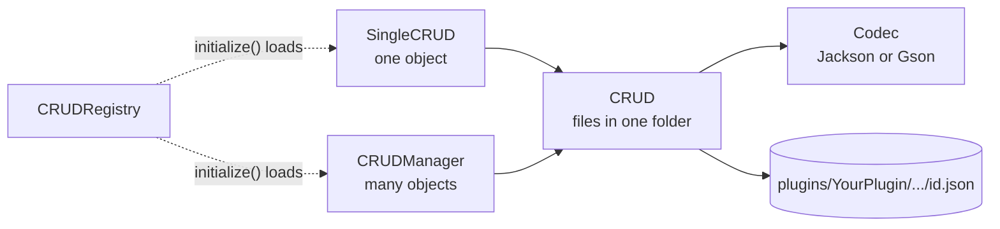

<div align="center">

# AbstractCRUD

[](https://jitpack.io/#MPGxxYT/AbstractCRUD)


Save Java objects as JSON files in your plugin's data folder, one file per object, and keep them in memory while the server runs.

</div>

AbstractCRUD is a small storage library for Paper and Bukkit plugins (it has no Bukkit dependency, so any Java 21 program can use it). You tell it which class to store, which folder to use and whether to use Jackson or Gson, and it reads and writes `<folder>/<id>.json` for you.

## Install

Add JitPack and the dependency to your `pom.xml`:

```xml
<repositories>
    <repository>
        <id>jitpack.io</id>
        <url>https://jitpack.io</url>
    </repository>
</repositories>

<dependency>
    <groupId>com.github.MPGxxYT</groupId>
    <artifactId>AbstractCRUD</artifactId>
    <version>v2.0.1</version>
</dependency>
```

If your plugin shades the library into its jar, also relocate it: see [Shading](docs/shading.md).

## Pick the class you need

| You want to store | Use | Example |
| --- | --- | --- |
| One object for the whole plugin | `SingleCRUD` | settings, a spawn point, a leaderboard |
| Many objects of the same kind, each with an id | `CRUDManager` | player profiles, arenas, shops |
| Files only, with no copy kept in memory | `CRUD` on its own | data you read once, or very rarely |

All three sit on a `CRUD`, which handles the files, and a `Codec`, which turns objects into JSON. A `CRUDRegistry` loads everything at startup.



## Quick start

A plugin that stores one `Settings` object and one `Profile` per player:

```java
import me.mortaldev.abstractcrud.crudapi.CRUD;
import me.mortaldev.abstractcrud.crudapi.CRUDManager;
import me.mortaldev.abstractcrud.crudapi.SingleCRUD;
import me.mortaldev.abstractcrud.crudapi.codec.Codec;
import me.mortaldev.abstractcrud.crudapi.codec.GsonCodec;
import me.mortaldev.abstractcrud.crudapi.loading.CRUDRegistry;

public final class MyPlugin extends JavaPlugin {
    private SingleCRUD<Settings> settings;
    private CRUDManager<Profile> profiles;

    @Override
    public void onEnable() {
        Codec codec = new GsonCodec();
        CRUDRegistry registry = new CRUDRegistry();
        Path data = getDataFolder().toPath();

        settings = new SingleCRUD<>(
            new CRUD<>(Settings.class, data, codec), "settings", Settings::new, registry);
        profiles = new CRUDManager<>(
            new CRUD<>(Profile.class, data.resolve("profiles"), codec), Profile::new, registry);

        registry.initialize(); // reads settings.json and profiles/*.json
    }
}
```

```java
Settings s = settings.get();            // plugins/MyPlugin/settings.json
s.motd = "Welcome back";
settings.save(s);

Profile p = profiles.getOrCreate(player.getUniqueId().toString());
p.level++;
profiles.save(p);                       // plugins/MyPlugin/profiles/<uuid>.json
```

[Quick start](docs/quick-start.md) has this as complete, copy-ready files with a test to run. [Getting started](docs/getting-started.md) builds it step by step and explains each line.

## Documentation

| Guide | Read it when |
| --- | --- |
| [Quick start](docs/quick-start.md) | You want working code to copy, with no explanations. |
| [Getting started](docs/getting-started.md) | You are setting up AbstractCRUD in a plugin for the first time and want to know how it works. |
| [Storing one object](docs/single-crud.md) | You use `SingleCRUD` for settings or other plugin-wide data. |
| [Storing many objects](docs/crud-manager.md) | You use `CRUDManager` for players, arenas or anything with an id. |
| [Serialization and custom types](docs/serialization.md) | You store `Location`, `ItemStack`, `UUID`, dates, or any class the JSON library can't handle alone. |
| [Shading](docs/shading.md) | You build a plugin jar that includes AbstractCRUD. |
| [Reference](docs/reference.md) | You want every method, the file layout, error behaviour and threading rules in one place. |
| [Migrating from 1.x](docs/MIGRATION_GUIDE.md) | Your plugin used `Jackson`, `GSON`, `CRUDAdapters` or subclassed `CRUD`. |
| [Glossary](GLOSSARY.md) | A term in these docs is unclear. |

## Building from source

```bash
git clone https://github.com/MPGxxYT/AbstractCRUD.git
cd AbstractCRUD
mvn clean install
```

This runs the tests and installs the library to your local Maven repository. [TESTING.md](TESTING.md) explains the test suite.
